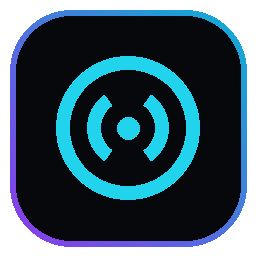

# FreeToPlayer 🎵

<p align="center">
  <strong>Современный настольный Hi-Fi музыкальный плеер и медиа-комбайн для Windows</strong><br>
  Построен на связке <em>Go + React 19 + TypeScript + Tailwind CSS + WebView2</em>
</p>

<p align="center">
  
</p>

<p align="center">
  
  
  
  
  
  
</p>

---

## 🌟 Возможности (Features)

### 🎧 Звуковой движок студийного уровня (Hi-Fi Web Audio Engine)
- **10-полосный параметрический эквалайзер** с компенсацией клиппинга (`preampGain`) и лимитером `-0.5 dBFS`.
- **Пиковый спектроанализатор в реальном времени** (режимы: Столбики, Волна, Симметрия, Пики).
- **Синхронный мульти-вывод звука:** одновременное воспроизведение в наушники и колонки с индивидуальным выбором аудиоустройств.
- **Интеллектуальная авто-пауза:** мгновенная пауза при входящих звонках или переключении Bluetooth-гарнитур Hands-Free.
- **Бесшовный переход (Gapless Preload):** предварительная подгрузка следующего трека за несколько секунд до окончания.

### 🔄 Бесшовная синхронизация медиатек
- **Встроенная авторизация Яндекс Музыка (Яндекс ID):**
  - Нативное встроенное окно авторизации через WebView2.
  - Автоматический перехват OAuth токена и моментальная докачка плейлиста «Любимое» с обложками высокого разрешения.
  - Отображение статуса аккаунта и бейджа активной подписки **«Плюс»**.
- **Встроенная авторизация YouTube Music:**
  - Вход в Google-аккаунт в 1 клик через встроенный браузер.
  - Автоматический захват сессионных cookies без ручной возни с расширениями браузера.
  - Загрузка как открытых, так и приватных плейлистов («Понравившиеся» `list=LM`).

### 📻 Онлайн-Поиск и Мировое Радио
- **Агрегатор источников:** поиск по Deezer, Яндекс Музыке, Hitmo, SoundCloud, VK, YouTube Music, Audius.
- **Каталог 40 000+ радиостанций:** интеграция с глобальной базой *Radio Browser API* с разбивкой по жанрам (Рок, Метал, Lo-Fi, Synthwave, Джаз, EDM) и странам.
- **Поддержка потокового аудио (Range 206 HTTP):** чанковая подгрузка треков без ожидания полного скачивания файла.

### 📱 Мобильное подключение (Mobile Remote Web PWA)
- Локальный веб-интерфейс для управления воспроизведением с телефона по Wi-Fi.
- Быстрое подключение по **QR-коду** из раздела «Настройки».
- Автоматический умный скоринг сетевых интерфейсов: отфильтровывает виртуальные подсети Radmin VPN и Hamachi, отдавая приоритет домашней Wi-Fi/LAN сети.

### 🎨 Интерфейс и Windows Интеграции
- **Apple Music-стиль развернутого плеера:** полноэкранный режим с живым синхронизированным караоке-текстом (LRCLIB).
- **5 цветовых палитр:** Pure Onyx, Cyberpunk Neon, Midnight Blue, Dracula, Nord Frost.
- **Windows 11 SMTC:** полная интеграция с системным оверлеем Windows Media Control (мультимедиа клавиши, обложка, громкость).
- **Discord Rich Presence:** нативный показ статуса трека, исполнителя и времени в профиле Discord.
- **Системный трей Windows:** быстрое сворачивание в трей при клике на кнопку «Tray» в шапке.

---

## 🧭 Структура проекта

```
dj/
├── FreeToPlayer.exe           # Готовый бинарник приложения (Windows GUI)
├── DJ-Player.exe              # Бинарник для совместимости ярлыков
├── sync_yandex_live.py        # Фоновый синхронизатор Яндекс Музыки
├── sync_youtube_live.py       # Фоновый синхронизатор YouTube Music
│
├── server/                    # Backend на Go (HTTP API + Win32 + WebView2)
│   ├── main.go                # Точка входа сервера и главное окно WebView2
│   ├── login_windows.go       # Нативные окна авторизации Яндекс ID и YouTube
│   ├── fullscreen.go          # Win32 обработка F11 и перемещение окон
│   ├── dark_titlebar.go       # DWM Dark Titlebar и перекраска заголовков Windows 11
│   ├── handlers.go            # Стриминг локальных треков и обложек
│   ├── handlers_extra.go      # Эндпоинты аккаунтов, синхронизации и сетевых IP
│   ├── online_music.go        # Онлайн-поиск и стриминговые прокси
│   ├── radio.go               # Резолвер каталога онлайн-радио
│   ├── discord.go             # Windows Named Pipes Discord IPC
│   ├── tray.go                # Shell_NotifyIcon трей Windows
│   └── dist/                  # Встроенный статический бандл фронтенда (embed.FS)
│
├── client/                    # Frontend на React 19 + TypeScript + Tailwind CSS
│   ├── src/
│   │   ├── App.tsx            # Корневой компонент и маршрутизация
│   │   ├── useAudioPlayer.ts  # Web Audio API граф, эквалайзер и синхронизация
│   │   ├── settings.ts        # Персистентное хранилище всех настроек
│   │   ├── theme.ts           # Цветовые темы оформления
│   │   └── components/
│   │       ├── Header.tsx             # Навигация, история, пластинка и полноэкранный режим
│   │       ├── HomeView.tsx           # Спектроанализатор и очередь с Drag-and-Drop
│   │       ├── CollectionView.tsx     # Медиатека: Все, Любимые, Плейлисты, Артисты
│   │       ├── OnlineSearchView.tsx   # Мировой поиск треков и Радио (40k+ станций)
│   │       ├── SettingsView.tsx       # Эквалайзер, аккаунты, темы, QR-код
│   │       └── NowPlayingExpanded.tsx # Развернутый караоке-плеер
│
└── data/                      # Пользовательские данные (добавлены в .gitignore)
    ├── audio/                 # Локальные аудиофайлы MP3/FLAC
    ├── covers/                # Кеш обложек треков
    └── library.json           # Локальная база метаданных
```

---

## 🛠️ Сборка из исходников

### Требования
1. **Windows 10/11 (64-bit)**
2. **Go 1.22+**
3. **Node.js 18+ & npm**
4. **Python 3.10+** (для фоновых модулей синхронизации `sync_*.py`)

### 1. Сборка фронтенда:
```powershell
cd client
npm install
npm run build
cd ..
```

### 2. Копирование дистрибутива в директорию сервера:
```powershell
Remove-Item -Path "server\dist\assets\*" -Force -ErrorAction SilentlyContinue
Copy-Item -Path "client\dist\*" -Destination "server\dist" -Recurse -Force
```

### 3. Компиляция бинарников Go:
```powershell
cd server
go build -ldflags="-H windowsgui" -o "..\FreeToPlayer.exe" .
go build -ldflags="-H windowsgui" -o "..\DJ-Player.exe" .
go build -ldflags="-H windowsgui" -o "dj-server.exe" .
cd ..
```

### 4. Запуск:
- Запустите `FreeToPlayer.exe` (графический интерфейс с нативным окном WebView2).
- Либо запустите в режиме фонового сервиса: `server\dj-server.exe --server-only`.

---

## 📄 Лицензия

Распространяется под сильной copyleft-лицензией **GNU General Public License v3.0 (GPLv3)**. Любые производные работы и форки обязаны также сохранять открытый исходный код под лицензией GPLv3. Подробности в файле `LICENSE`.
